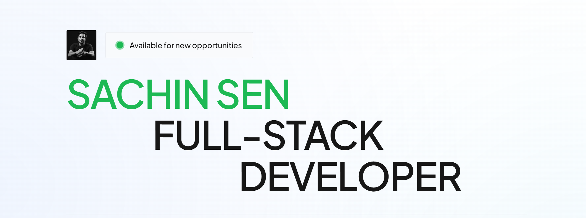
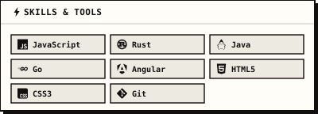
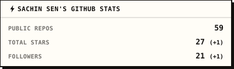
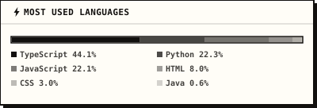
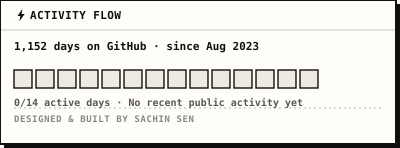

 

<table width="100%">
<tr>
<td width="33%" align="center"></td>
<td width="33%" align="center"></td>
<td width="33%" align="center"></td>
</tr>
</table>

---

## 👋 About Me

Hi, I'm **Sachin Sen**, a full-stack developer from India who likes building real products end to end: frontend, backend, database, and deployment.

- 🔭 Currently building **Blip**, a smart text expander that notices what you repeat and offers to save it as a snippet
- 🌱 Exploring **Rust** and **Go** alongside my main MERN / Next.js stack
- 🛠️ Main stack: **MERN · Next.js · React Native · TypeScript · PostgreSQL**
- 💬 Ask me about full-stack web apps, SaaS products, and API design
- 🌐 Portfolio: [sachinsen.vercel.app](https://sachinsen.vercel.app/)

---

---

## 🚀 Featured Projects

| Project | What it is | Stack |
| --- | --- | --- |
| [**Blip**](https://github.com/Sachinsen7/blip) / [**Blip Desktop**](https://github.com/Sachinsen7/blip-desktop) | Text expander that detects phrases you type repeatedly and offers to turn them into snippets. The desktop version is Windows-native and works in any app. | JavaScript, Rust |
| [**Purgr**](https://github.com/Sachinsen7/Purgr) | Open-source Python tool, my most-starred repo (16 ⭐). | Python |
| [**cloud-saas**](https://github.com/Sachinsen7/cloud-saas) | SaaS combining video processing, AI image analysis, document conversion, and social content creation on Cloudinary. | Next.js, TypeScript, Prisma, PostgreSQL, Clerk |
| [**EndpointHub**](https://github.com/Sachinsen7/EndPointHub) | Free-first API marketplace to publish, discover, and consume APIs, with API key management. | React, Redux, Docker, PostgreSQL, Redis |
| [**Techora**](https://github.com/Sachinsen7/techora) | Full-stack LMS inspired by Udemy and Coursera. | MERN |
| [**VidTube**](https://github.com/Sachinsen7/vidtube) | YouTube-style video platform with JWT auth, uploads, comments, likes, and playlists. | React, Node.js, Express, Zustand, MUI |

More on my [repositories page](https://github.com/Sachinsen7?tab=repositories).

---

## 🧰 Tech I Work With

---

<table width="100%">
<tr>
<td width="50%"></td>
<td width="50%"></td>
</tr>
</table>

---

## 📫 Let's Connect

I'm open to freelance work, collaborations, and full-time opportunities.

- 📧 [sachinsen1920@gmail.com](mailto:sachinsen1920@gmail.com)
- 💼 [LinkedIn](https://linkedin.com/in/sachinsen1)
- 🐦 [X / Twitter](https://x.com/sen_sachiin)
- 📸 [Instagram](https://www.instagram.com/sensachiin)
